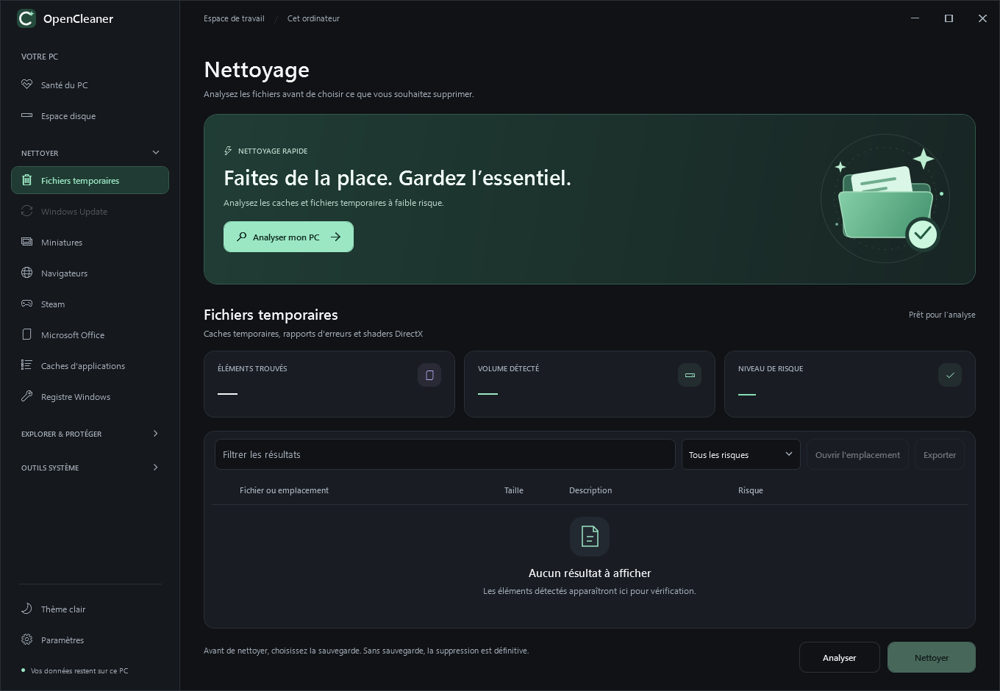
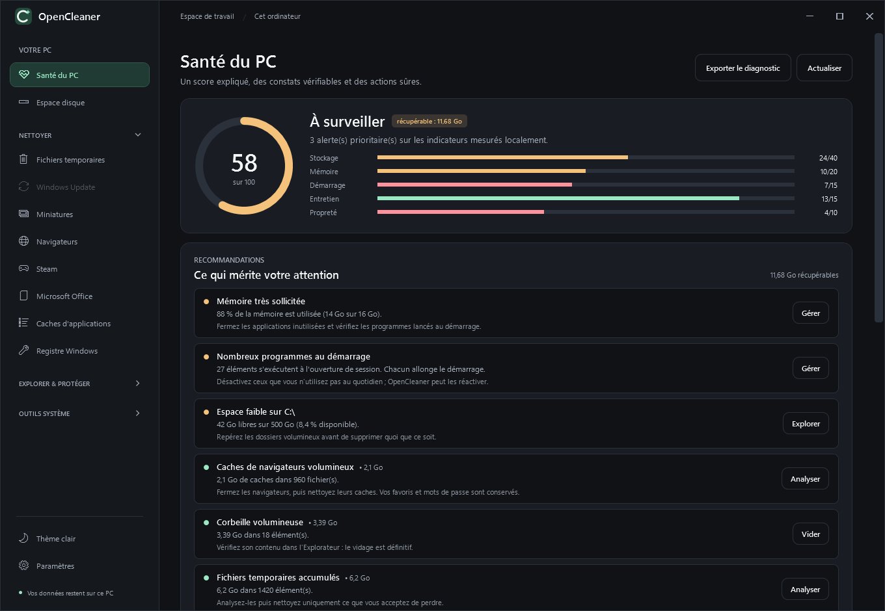
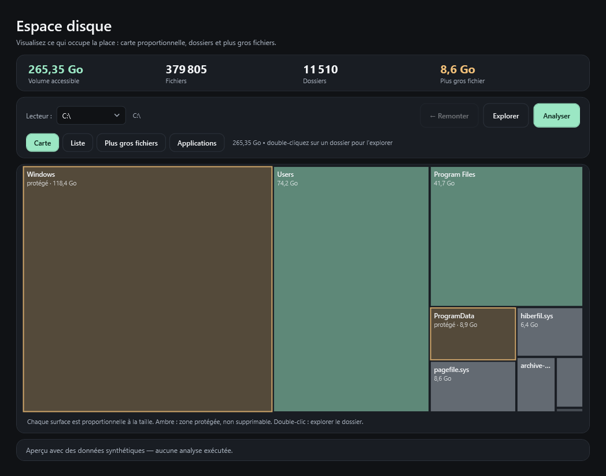
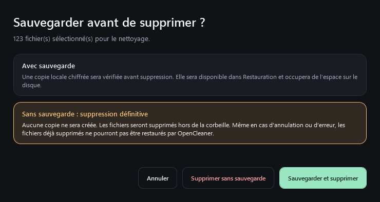

  

<h1 align="center">OpenCleaner</h1>

  <strong>De l’air pour votre PC.</strong> 
  Repérez les fichiers inutiles, comprenez ce qui occupe votre disque et choisissez ce que vous nettoyez.

  Windows 10 et 11 · 64 bits · Français / English 
  Gratuit et open source · Sans publicité · Sans compte · Sans télémétrie applicative

  <a href="https://github.com/VictorCESIVA/OpenCleaner/releases/latest/download/OpenCleaner-win-x64-Setup.exe"><strong>Télécharger pour Windows</strong></a>
  · <a href="https://github.com/VictorCESIVA/OpenCleaner/releases/latest/download/OpenCleaner-win-x64-Portable.zip">Version portable</a>
  · <a href="#premiers-pas">Premiers pas</a>
  · <a href="https://github.com/VictorCESIVA/OpenCleaner/issues">Signaler un problème</a>

<picture>
  <source media="(prefers-color-scheme: light)" srcset="docs/preview/readme-light.png">
  <source media="(prefers-color-scheme: dark)" srcset="docs/preview/readme-dark.png">
  
</picture>

*Captures de la version en développement : l’apparence peut différer de la version disponible au téléchargement.*

## Télécharger et installer

1. Téléchargez [l’installateur pour Windows](https://github.com/VictorCESIVA/OpenCleaner/releases/latest/download/OpenCleaner-win-x64-Setup.exe).
2. Ouvrez le fichier **OpenCleaner-win-x64-Setup.exe**.
3. Lancez l’installation, puis ouvrez **OpenCleaner**.

L’application est prévue pour **Windows 10 et 11 en 64 bits**. Les versions distribuées incluent le nécessaire pour fonctionner : vous n’avez pas besoin d’installer le SDK .NET ni de compiler le projet.

**Vous préférez une version sans installation ?** Téléchargez [l’archive portable](https://github.com/VictorCESIVA/OpenCleaner/releases/latest/download/OpenCleaner-win-x64-Portable.zip), décompressez-la dans un dossier, puis lancez **OpenCleaner.UI.exe**.

Si vous utilisez les sauvegardes, conservez le **code de récupération** dans un endroit sûr. Il permet de les déverrouiller si leur clé locale devient inaccessible.

## Ce que vous pouvez faire

| Votre besoin | Dans OpenCleaner |
| --- | --- |
| Faire un premier tri | **Nettoyage rapide** analyse les caches et les fichiers temporaires à faible risque. |
| Nettoyer une catégorie précise | **Fichiers temporaires**, **Navigateurs**, **Miniatures** et caches d’applications permettent un nettoyage ciblé. |
| Comprendre où part l’espace | **Espace disque** affiche une carte des dossiers, les plus gros fichiers et les applications associées. Cette analyse ne supprime rien. |
| Faire le point sur le PC | **Santé du PC** présente un score expliqué, les points à vérifier et l’historique des nettoyages. |
| Repérer des copies de fichiers | **Doublons** compare leur contenu et identifie l’original à conserver avant de proposer les copies à supprimer. |
| Gérer les logiciels | **Démarrage**, **Désinstaller** et **Mises à jour** réunissent les actions courantes. |
| Choisir comment supprimer | Avant chaque nettoyage, choisissez **Sauvegarder et supprimer** ou **Supprimer sans sauvegarde**. |
| Retrouver un fichier sauvegardé | **Restauration** permet de restaurer uniquement les fichiers dont vous avez conservé une sauvegarde. |
| Adapter le nettoyage | **Paramètres** permet d’exclure des dossiers et de planifier un nettoyage à faible risque, avec ou sans sauvegarde. |

| Santé du PC | Espace disque |
| --- | --- |
|  |  |

*Les vues Santé du PC et Espace disque ci-dessus utilisent des données d’exemple.*

<strong>Navigateurs et applications pris en charge</strong>

- **Navigateurs** : Chrome, Edge, Brave, Firefox, Opera et Vivaldi, sur plusieurs profils.
- **Applications** : certains caches et journaux de Steam, Microsoft Office, Thunderbird, Teams, Discord, Spotify, Slack, Notion, WhatsApp, Signal, Zoom, Microsoft Store et OneDrive.
- **Outils développeur et IA** : caches de npm, Yarn, NuGet, pip, Gradle, VS Code, JetBrains, Cursor, Claude et ChatGPT.

La prise en charge porte sur des emplacements de caches ou de journaux précis. Selon la version et le mode d’installation de l’application, certains éléments peuvent ne pas être détectés.

Les cookies et l’historique des navigateurs restent des options explicites. Leur suppression peut vous déconnecter de vos sites. Fermez vos navigateurs avant de nettoyer leurs fichiers.

## Premiers pas

1. **Analysez.** Cliquez sur **Analyser mon PC** pour le nettoyage rapide, ou choisissez une catégorie puis **Analyser**. L’analyse ne supprime aucun fichier.
2. **Vérifiez.** Consultez les chemins, les tailles et les niveaux de risque. Pour un nettoyage ciblé, sélectionnez uniquement les lignes souhaitées. Sans sélection, le nettoyage porte sur les résultats affichés, recherche et filtre compris.
3. **Choisissez.** Cliquez sur **Nettoyer** ou **Nettoyer les résultats**. La confirmation propose **Sauvegarder et supprimer**, **Supprimer sans sauvegarde** ou **Annuler**. Le choix est redemandé à chaque nettoyage manuel.
4. **Supprimez selon votre choix.** Avec sauvegarde, une copie chiffrée est vérifiée avant suppression et reste accessible dans **Restauration**. Sans sauvegarde, aucune copie n’est créée : le fichier est supprimé définitivement, hors de la corbeille.

**Sans sauvegarde, il n’y a pas de restauration OpenCleaner.** Une annulation arrête les suppressions suivantes ; les fichiers déjà supprimés restent supprimés, même si une erreur interrompt le nettoyage.

### Comprendre les niveaux de risque

| Niveau | Comment l’aborder |
| --- | --- |
| **Faible** | Commencez par ces éléments. La suppression d’un cache peut tout de même entraîner son téléchargement ou sa reconstruction par l’application. |
| **À vérifier** | Relisez chaque résultat : ces données peuvent vous être utiles, comme les cookies d’un navigateur. |
| **Expert** | Réservé aux utilisateurs qui comprennent les conséquences de la suppression, notamment pour le registre. |

## Vos fichiers et votre vie privée

- **Sauvegarde à votre choix** : une copie locale chiffrée est créée et vérifiée uniquement si vous choisissez **Sauvegarder et supprimer**. Une sauvegarde demandée qui échoue bloque la suppression du fichier concerné.
- **Dossiers exclus** : ajoutez les emplacements à conserver dans **Paramètres > Dossiers exclus**. L’exclusion couvre aussi leurs sous-dossiers.
- **Protections système** : les emplacements critiques et les liens vers d’autres dossiers sont refusés par le moteur de nettoyage.
- **Utilisation locale** : aucun compte n’est nécessaire. Le nettoyage fonctionne hors ligne ; la recherche des mises à jour contacte GitHub et les mises à jour logicielles utilisent Windows Package Manager.

**Avec sauvegarde, les copies prennent de la place.** Si elles restent sur le même disque, le volume détecté ne correspond pas forcément à l’espace immédiatement libéré. Dans **Restauration**, supprimez uniquement les copies dont vous n’avez plus besoin. **Sans sauvegarde, aucune copie ne reste à supprimer dans Restauration.** Les anciennes sauvegardes sont conservées jusqu’à leur suppression par vos soins.

**Pour un nettoyage planifié**, choisissez l’option de sauvegarde dans les paramètres : le choix s’appliquera à chaque exécution. Les planifications existantes gardent leurs sauvegardes tant que vous ne modifiez pas ce réglage.

**Certaines actions n’ont pas de retour par les sauvegardes OpenCleaner.** Le vidage de la corbeille et l’effacement sécurisé ne créent pas de sauvegarde. Les modifications du registre nécessitent une restauration manuelle depuis les exports. Sur SSD, l’effacement définitif ne peut pas être garanti.

OpenCleaner ne remplace pas un antivirus, une sauvegarde de vos documents ni un diagnostic matériel. Le nettoyage direct de Windows Update est suspendu.

## À votre façon

Choisissez le **thème clair ou sombre** depuis la barre latérale. Dans **Paramètres > Langue**, passez du français à l’anglais sans redémarrer l’application. Les transitions respectent le réglage d’animations de Windows.

Un bandeau vous prévient lorsqu’un disque manque d’espace. Le seuil est réglable dans les paramètres ; l’alerte ne lance aucun nettoyage.

### Raccourcis utiles

| Raccourci | Action |
| --- | --- |
| <kbd>F5</kbd> | Relancer l’analyse ou actualiser la page compatible. |
| <kbd>Échap</kbd> | Annuler l’opération en cours. |
| <kbd>Ctrl</kbd> + <kbd>F</kbd> | Rechercher dans les résultats du nettoyage. |
| <kbd>Ctrl</kbd> + <kbd>E</kbd> | Exporter le rapport d’analyse en JSON. |
| Flèches et <kbd>Entrée</kbd> | Parcourir la carte d’espace disque et ouvrir l’élément choisi. |

## Questions fréquentes

<strong>Comment mettre OpenCleaner à jour ?</strong>

Dans **Paramètres**, cliquez sur **Vérifier les mises à jour**. Une installation via **Setup.exe** recherche également les mises à jour au démarrage. L’application demande votre accord avant de redémarrer pour appliquer une mise à jour. Pour une version portable, téléchargez la nouvelle version depuis [GitHub Releases](https://github.com/VictorCESIVA/OpenCleaner/releases/latest).

<strong>Pourquoi Windows affiche-t-il un avertissement au lancement ?</strong>

Certaines versions ne sont pas signées numériquement et peuvent déclencher un avertissement SmartScreen. Vérifiez que le fichier provient des [versions officielles du projet](https://github.com/VictorCESIVA/OpenCleaner/releases). Le caractère open source ne garantit pas à lui seul la sûreté d’un fichier téléchargé.

<strong>Faut-il lancer l’application en administrateur ?</strong>

Commencez par un lancement normal. Certaines actions, comme la modification d’éléments de démarrage pour tous les utilisateurs ou les mises à jour logicielles, demandent une autorisation administrateur au moment de l’opération.

## Besoin d’aide ?

[Signalez un problème ou proposez une amélioration](https://github.com/VictorCESIVA/OpenCleaner/issues). Indiquez votre version de Windows, la version d’OpenCleaner et les étapes pour reproduire le problème. Masquez les chemins personnels et les informations sensibles dans vos captures et rapports.

Pour contribuer au code ou consulter le détail des mécanismes de sécurité : [documentation technique](docs/TECHNICAL.md).

OpenCleaner est distribué sous [licence MIT](LICENSE).
