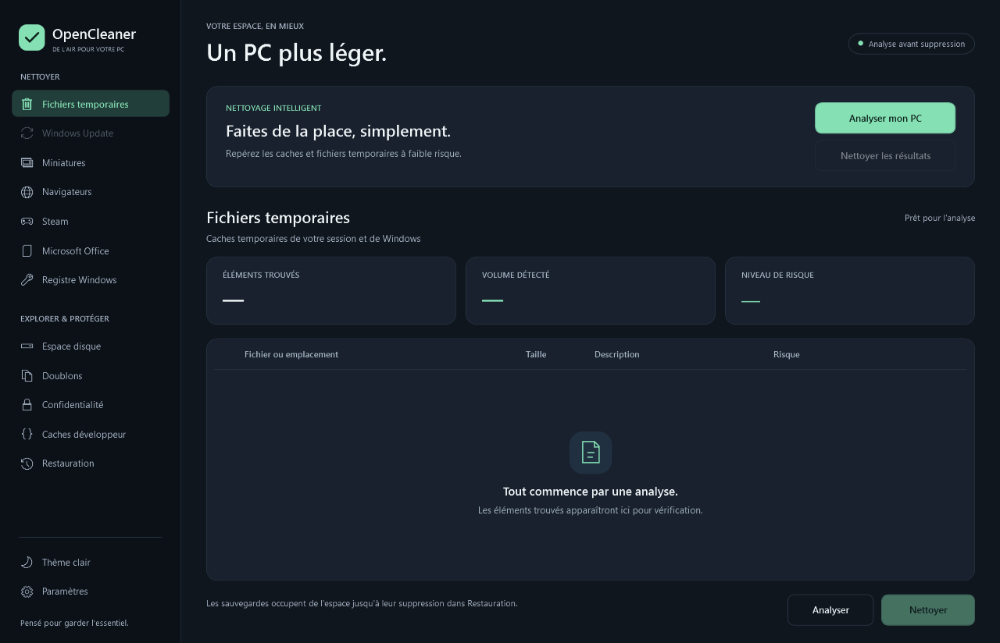
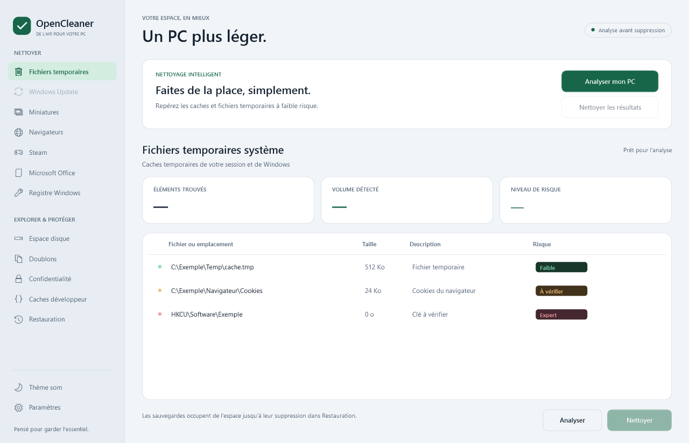

# Audit OpenCleaner — 14 octobre 2026

## Résultat

Audit du code source, des dépendances, des opérations destructives, de la persistance, des workflows et de l'interface. Correctifs appliqués localement, interface des sept fenêtres refondue, compilation et tests validés. Aucune publication GitHub ni installation effectuée.

**Validation finale : 56 tests réussis (43 Core, 13 plugins), aucun test ignoré, compilation Release avec --warnaserror sans avertissement ni erreur. Aucune vulnérabilité connue signalée par NuGet sur les dépendances directes et transitives.**

Il s'agit d'un audit technique du dépôt avec régressions ciblées, pas d'une certification de sécurité. Les tests de nettoyage utilisent des fixtures temporaires ; aucun nettoyage de fichiers personnels, aucune création de tâche Windows réelle ni suppression de clé du registre existant n'ont été lancés.

## Défauts repérés et corrections

| Priorité | Constat avant correction | Correction appliquée |
|---|---|---|
| P1 | Certaines suppressions de caches contournaient le gardien ou continuaient après un échec de sauvegarde. | Tous les nettoyeurs de fichiers passent par le gardien. Une sauvegarde manquante ou incohérente bloque la suppression. |
| P1 | Jonctions, chemins spéciaux, racines et chemins système sur d'autres lecteurs pouvaient échapper aux protections. | Validation commune des composants du chemin, refus des liens/jonctions, chemins réseau/périphériques, ADS et racines ; protections basées aussi sur les dossiers Windows réels. |
| P1 | Un fichier pouvait être remplacé entre la vérification et la suppression. | Sous Windows, ouverture d'un handle avec droit de suppression, refus du partage écriture/suppression, vérification du chemin final et du SHA-256, puis suppression de ce même objet. |
| P1 | Restauration sans vérification du contenu, identifiant de sauvegarde permettant des chemins arbitraires. | Identifiants GUID uniquement ; taille et SHA-256 vérifiés ; fichier de remplacement préparé avant permutation ; sauvegarde du fichier existant avant remplacement. |
| P1 | Purge des sauvegardes susceptible de suivre des liens ou de supprimer des dossiers non reconnus. | Purge bornée au répertoire de sauvegarde, aux dossiers reconnus et à la date de leurs métadonnées ; liens refusés. |
| P1 | Récupération Office, cache de synchronisation, node_modules et contextes Docker traités comme données jetables. | Cibles retirées. Office se limite aux journaux ciblés ; Dev se limite aux caches et journaux connus. Les projets et configurations sont conservés. |
| P1 | Nettoyage direct de Windows Update sans coordination suffisante avec les services Windows. | Module rendu indisponible et exclu du planificateur ; explication affichée dans l'interface. |
| P1 | Sélection forgée, périmée ou issue d'une nouvelle instance du plugin. | Chaque nettoyeur conserve le dernier scan et vérifie l'identité, la taille, la date et la sûreté du chemin ; les fenêtres réutilisent la même instance pour analyser et nettoyer. |
| P1 | Doublons supprimables après changement de la copie conservée ; regroupement UI basé sur le nom affiché. | Métadonnées de groupe explicites, empreintes revérifiées et original maintenu ouvert contre écriture/suppression pendant le nettoyage ; chemin conservé visible. |
| P1 | Scanner de confidentialité proposant des configurations actives et supprimant tous les résultats en absence de sélection. | Recherche bornée hors AppData, résultats Expert uniquement, sélection explicite obligatoire ; regex avec délai maximal et absence de secrets affichés. |
| P1 | Fermeture brutale des navigateurs avec Kill(). | Fermeture forcée supprimée ; demande de fermer soi-même les applications, puis nettoyage refusé si elles tournent encore. |
| P1 | Redémarrage automatique pour mise à jour susceptible d'interrompre un nettoyage. | Recherche au démarrage informative ; téléchargement et redémarrage manuels, avec vérification de l'opération en cours après la confirmation. |
| P1 | Plusieurs fenêtres ou plusieurs processus pouvaient travailler simultanément sur les mêmes fichiers. | Coordinateur d'opération commun aux fenêtres et mutex Windows par utilisateur, partagé entre sessions et entre interface/planificateur. |
| P1 | SQLite natif vulnérable, anciennes dépendances de tests vulnérables. | Microsoft.Data.Sqlite et extensions Microsoft 10.0.13, xUnit 2.9.3, Test SDK 18.11.0, runner 3.1.5, collector 6.0.4, Velopack 1.2.161 ; contrôle NuGet transitif bloquant. |
| P2 | Rollback dépendant de la mémoire et faux état de succès après restauration incomplète. | Transactions et opérations relues depuis SQLite, ordre de restauration inversé, échecs et annulations conservés explicitement. |
| P2 | Exports du registre incorrects pour binaire, QWORD, chaînes Unicode et variables d'environnement. | Export UTF-16 et représentations .reg corrigées ; protection des ancêtres des clés sensibles ; modification de clés feuilles uniquement. |
| P2 | Statistiques annonçant le volume choisi comme espace réellement libéré. | Compteurs provenant des opérations réussies. Gain net annoncé à zéro lorsque la copie de sauvegarde est conservée. L'interface distingue le volume détecté de l'espace récupéré. |
| P2 | Mode rapide acceptant des risques non validés et masquant les échecs/délais dépassés comme résultats vides. | Fichiers Safe uniquement, exclusion des répertoires et de Recommended/Expert ; erreurs d'analyse conservées et état partiel visible. Service Workers désactivés par défaut. |
| P2 | Scans bloquant le dispatcher WPF, navigation/options modifiables pendant l'opération, états périmés. | I/O hors du thread UI, options et navigation bloquées pendant le travail, invalidation après changement d'option, notifications de progression bornées à la durée de l'opération. |
| P2 | Planification acceptant des identifiants arbitraires et désactivation échouant silencieusement. | Validation des jours/heures, whitelist de cinq modules, JSON remplacé atomiquement, chevauchement des tâches interdit et erreurs Windows remontées. |
| P2 | Seul un workflow de publication existait, sans tests préalables. | CI Windows sur push/PR, compilation stricte, tests et contrôle WPF ; mêmes vérifications avant publication. Tags validés et arguments fournis via variables d'environnement. |
| P2 | 1 247 fichiers bin/obj étaient suivis malgré .gitignore. | Retirés de l'index Git, conservés sur disque. Ignore étendu aux packages, aperçus temporaires, outils et résultats de tests. |
| P2 | README et site promettant Firefox, corbeille, DLL externes et nettoyage de projets non implémentés. | Documentation alignée sur le code réel ; liens du dépôt corrigés et affirmation de sûreté absolue retirée ; fichier MIT ajouté conformément à la licence annoncée. |
| P2 | Site dépendant d'un script CDN @latest et de polices externes, contenu masqué sans JavaScript. | Icônes SVG locales et polices système, contenu visible sans script, animations réduites selon préférence utilisateur, appels GitHub bornés et URL de téléchargement contrôlée. |

## Interface

Palette graphite et menthe, typographie Segoe UI, navigation structurée, cartes de synthèse, icônes sobres et résultats virtualisés. Les fenêtres Système, Paramètres, Restauration, Doublons, Confidentialité, Espace disque et Caches développeur partagent les thèmes sombre/clair.

États vides explicites, focus clavier visible, contrastes des données corrigés, libellés de risque français, dates des sauvegardes converties en heure locale. Défilement et disposition des actions vérifiés aux dimensions minimales. Le spinner existant a conservé sa rotation sur la grille ; un bouton d'annulation est disponible dans la fenêtre principale. Fermer une fenêtre pendant son opération demande l'annulation, puis la fenêtre peut être fermée après la fin de celle-ci.

Les aperçus ont été générés depuis les vrais constructeurs et ressources WPF. Les lignes montrées dans le thème clair sont des exemples synthétiques.

## Validation reproductible

Commandes exécutées :

- dotnet build OpenCleaner.sln -c Release --warnaserror
- dotnet test OpenCleaner.sln -c Release --no-build
- dotnet list OpenCleaner.sln package --vulnerable --include-transitive
- dotnet run --project tools/OpenCleaner.Preview -c Release -- artifacts/ui-preview
- node --check docs/script.js
- dotnet publish src/OpenCleaner.UI/OpenCleaner.UI.csproj -c Release -r win-x64 --self-contained true -p:PublishSingleFile=true -p:RuntimeFrameworkVersion=10.0.13 -o artifacts/publish
- vpk pack -u OpenCleaner -v 1.0.2 -p artifacts/publish --mainExe OpenCleaner.UI.exe --runtime win-x64 --channel win-x64 -o artifacts/release-x64

Les 48 tests ajoutés aux huit existants vérifient notamment : jonctions NTFS réelles, racines et ADS, corruption/traversal des sauvegardes, refus après modification du fichier, absence de suppression après échec de sauvegarde, annulation, préservation des copies de sauvegarde, rollback après nouvelle instance du moteur, export du registre, sélection forgée/périmée, original conservé des doublons et filtrage du mode automatique.

Le contrôle WPF instancie les sept fenêtres sans déclencher OnStartup, scan, nettoyage ou planification. Les rendus couvrent dimensions normales/minimales, thèmes sombre/clair, options navigateur, chargement et lignes synthétiques.

## Livrables locaux

- Exécutable autonome : artifacts/publish/OpenCleaner.UI.exe, avec ses DLL natives voisines.
- Archive portable complète : artifacts/release-x64/OpenCleaner-win-x64-Portable.zip.
- Installateur préparé : artifacts/release-x64/OpenCleaner-win-x64-Setup.exe.
- Captures détaillées : artifacts/ui-preview/.
- Aperçus durables : docs/preview/.
- Empreintes des livrables : artifacts/checksums.json.

Les packages ont été générés localement et ne sont pas signés numériquement. La version du projet reste 1.0.2 ; aucune release publique n'a été remplacée. Le dossier artifacts/release issu du premier essai de packaging n'est pas le livrable retenu ; utiliser release-x64, explicitement construit pour win-x64.

## Limites restantes

1. **Données de sauvegarde** : copies locales non chiffrées et métadonnées non signées. SHA-256 détecte une corruption, mais ne protège pas contre un processus du même compte qui modifierait simultanément le contenu et les métadonnées. Les copies de traces sensibles restent elles-mêmes sensibles.
2. **Atomicité** : le journal SQLite ne forme pas une transaction atomique avec NTFS. Le moteur de transactions est testé, mais n'est pas branché au parcours de nettoyage WPF ; la restauration proposée par l'interface reste par fichier, via les sauvegardes. Les arrêts brutaux demandent vérification des sauvegardes et résultats.
3. **Processus local hostile** : les validations et handles renforcent la suppression de fichiers, mais la restauration et les opérations sur répertoires ne constituent pas une frontière de sécurité contre un attaquant local modifiant les parents au même instant.
4. **Registre** : les exportations se trouvent dans %LOCALAPPDATA%/OpenCleaner/RegistryBackups et nécessitent un import manuel vérifié. La fenêtre Restauration gère les sauvegardes de fichiers, pas les exports .reg.
5. **Scans partiels** : accès refusés, dossiers système, jonctions et certains emplacements OneDrive peuvent être exclus. L'analyse disque n'est pas une mesure exhaustive du volume. La recherche de confidentialité repose sur des heuristiques et peut manquer des secrets ou signaler des faux positifs.
6. **Coût du nettoyage** : hashing et copie avant suppression favorisent la conservation des données mais augmentent I/O, durée et occupation temporaire du disque. Les sauvegardes ne sont pas purgées automatiquement sans demande explicite.
7. **Intégration Windows** : le fonctionnement réel des tâches planifiées, de la mise à jour d'une installation Velopack existante et du nettoyage de caches sur plusieurs machines/profils reste à tester sur un environnement dédié. Les tests locaux n'ont pas touché ces données réelles.
8. **Signature et distribution** : installer non exécuté, signature numérique absente, pas de publication distante. Les anciens téléchargements et l'ancienne archive à la racine sont antérieurs à ces correctifs.

## Maintenance

Le SDK est fixé à .NET 10 LTS avec roll-forward vers une feature band stable disponible. Les dépendances vulnérables connues sont refusées lors de la restauration. Maintenir le SDK/runtime Windows à jour et conserver les tests sur Windows/NTFS.

La migration quitte .NET 8, dont le support prend fin le 10 novembre 2026 : [annonce Microsoft](https://devblogs.microsoft.com/dotnet/dotnet-8-9-end-of-support/). .NET 10 LTS est suivi par la [politique officielle de support](https://dotnet.microsoft.com/fr-fr/platform/support/policy). Les options de packaging ont été vérifiées via la CLI installée et la [référence officielle Velopack](https://docs.velopack.io/reference/cli/content/vpk-windows).
