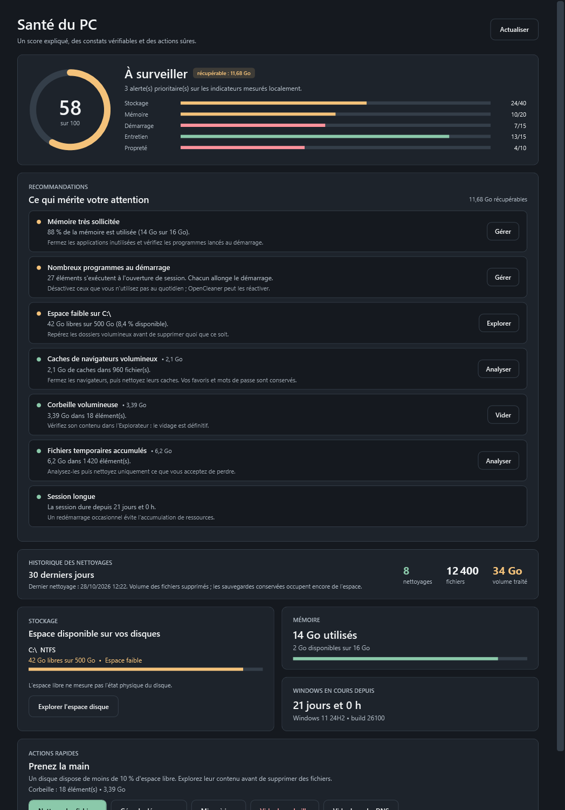
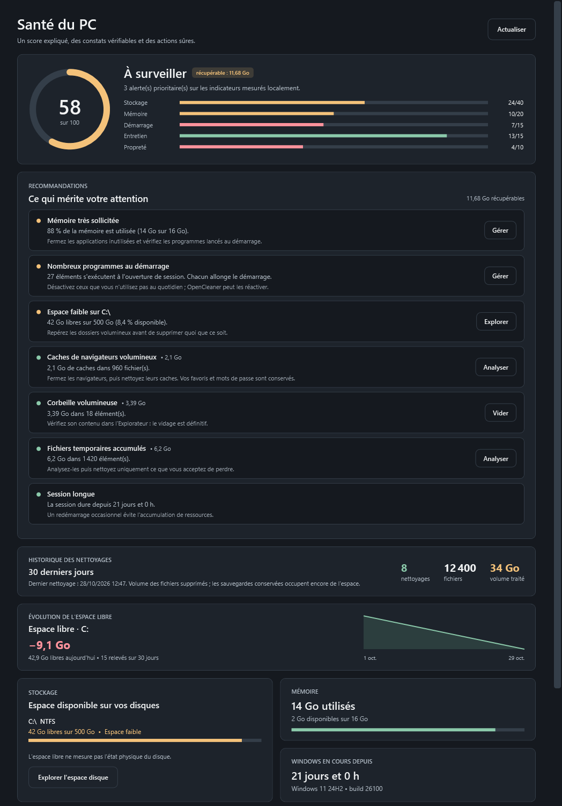
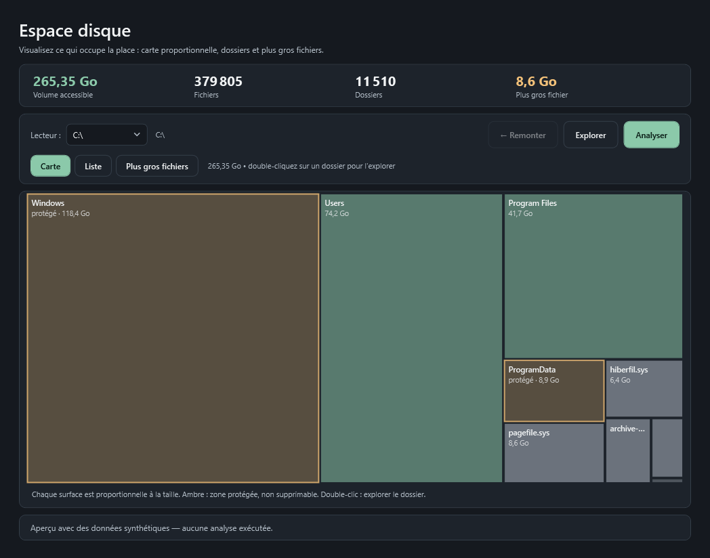
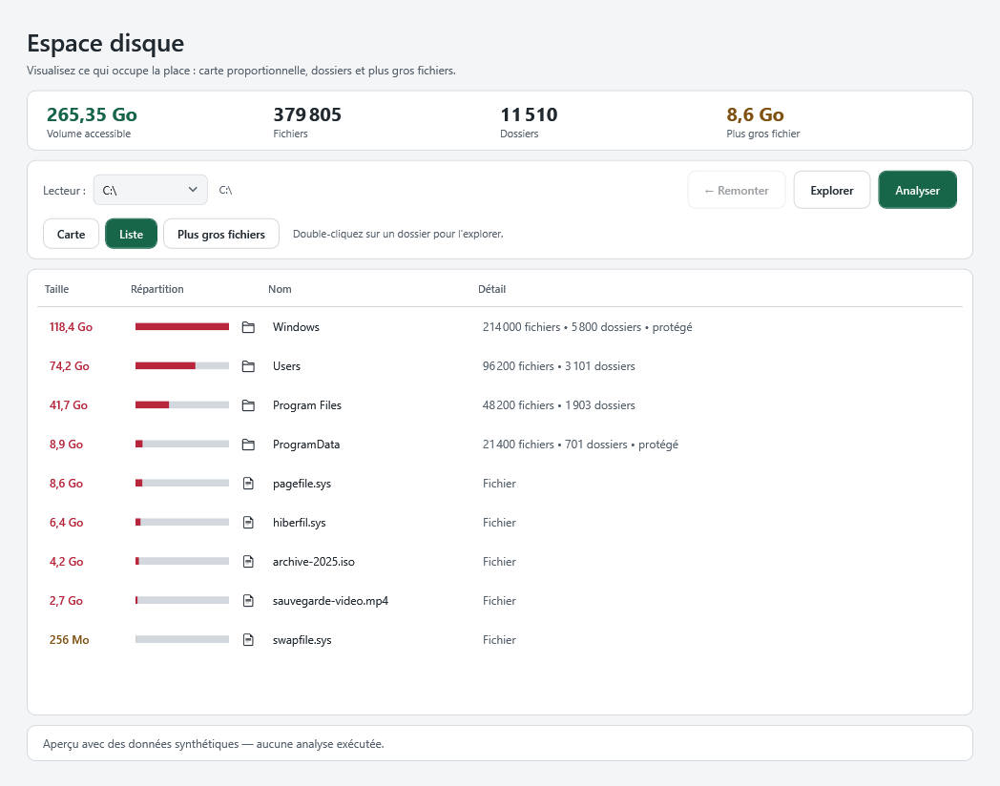
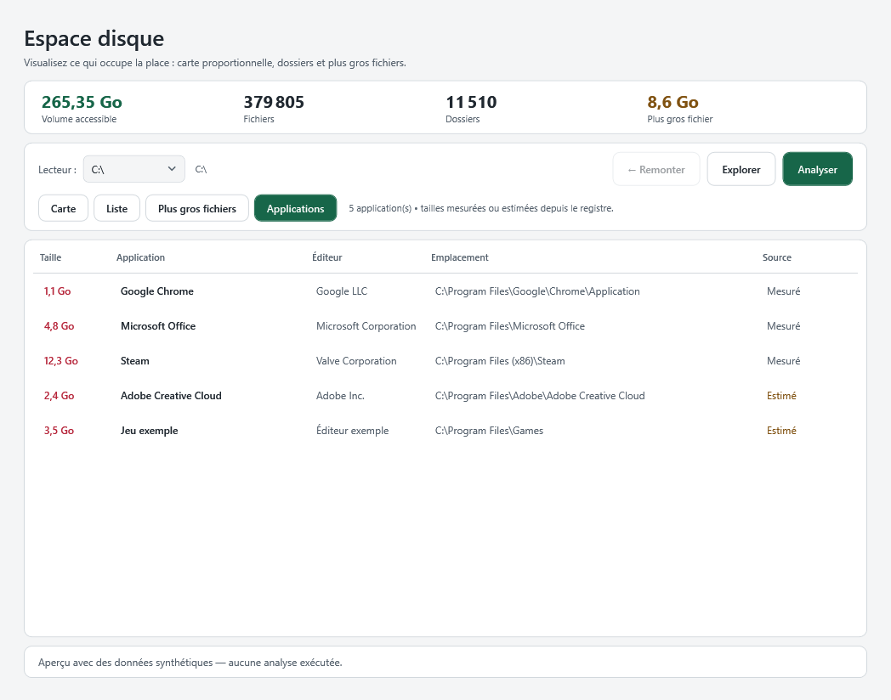
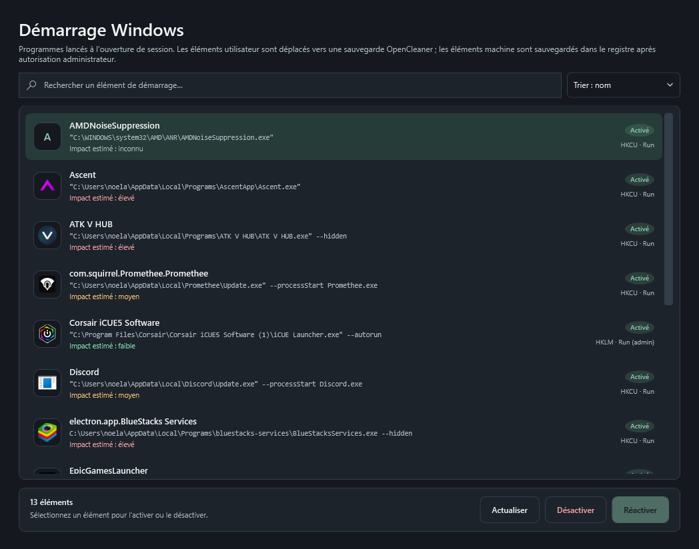

# Audit OpenCleaner — 29 octobre 2026

## Résultat

Cet incrément fait passer OpenCleaner en 1.4.0 avec plusieurs fonctions visibles et un diagnostic plus utile :

- **Santé du PC** : score explicable sur 100, cinq sections mesurées, constats et actions.
- **Espace disque** : carte proportionnelle, navigation instantanée dans l'arborescence déjà scannée, liste et plus gros fichiers.
- **Démarrage Windows** : impact estimé et tri, sans modification supplémentaire du système.

**Validation finale : 218 tests réussis (189 Core, 21 plugins, 8 interface), compilation Release avec `--warnaserror`, aperçus WPF clair/sombre et analyse réelle en lecture seule.** Aucun nettoyage, aucune suppression et aucune modification du registre n'ont été exécutés pendant la vérification.

- **Historique des nettoyages** : synthèse des 30 derniers jours (nettoyages, fichiers, volume supprimé) lue dans le journal SQLite, sans exposer les chemins.
- **Navigateurs** : canaux bêta, dev et canary de Chrome, Edge, Brave et Vivaldi, plus Opera Beta et Developer ; la détection d'activité reste partagée par moteur.
- **Démarrage machine** : les clés HKLM Run/RunOnce sont modifiables après autorisation administrateur, avec sauvegarde vérifiée dans `HKLM\SOFTWARE\OpenCleaner\DisabledStartup`.
- **Évolution de l'espace libre** : un relevé quotidien local (une valeur par jour et par volume, sans chemin) alimente une courbe sur 30 jours et indique la variation.

## Constats et corrections

| Priorité | Constat | Correction |
|---|---|---|
| P1 | La page Santé affichait des mesures brutes sans synthèse ni priorisation. | Score sur 100 réparti en stockage (40), mémoire (20), démarrage (15), entretien (15) et propreté (10), avec seuils documentés et constats triés par gravité. |
| P1 | Aucun moyen de savoir si les caches pesaient lourd sans lancer un nettoyage. | Mesure en lecture seule des caches temporaires, miniatures et navigateurs, plafonnée à 5 s ; l'état partiel est affiché et rien n'est supprimé. |
| P1 | L'analyseur d'espace rescannait le disque à chaque double-clic et n'offrait qu'une liste plate. | Un seul parcours construit l'arborescence ; la navigation, la carte et la liste utilisent ensuite ces données en mémoire. |
| P1 | La carte proportionnelle n'existait pas et les seuls repères de taille étaient des barres. | Algorithme de treemap « squarified » pur, testé (aires, absence de chevauchement, bords, cas dégénérés), rendu WPF sans dépendance externe. |
| P1 | Des dossiers critiques auraient pu paraître nettoyables dans l'analyseur. | Le gardien marque les chemins protégés ; la carte et la liste les signalent en ambre et l'analyseur reste strictement en lecture seule. |
| P2 | L'application ne montrait pas ce qui avait déjà été nettoyé, alors que le journal SQLite contenait ces données. | Service de lecture seule agrégeant les transactions validées sur 30 jours ; aucun chemin n'est lu ni affiché, les lignes anciennes sans taille restent tolérées. |
| P1 | Le détecteur de doublons proposait de supprimer des noms physiques d'un même fichier : l'opération ne libère aucun octet et gonfle le gain annoncé. | Comptage des liens physiques avant proposition et nouvelle vérification juste avant la suppression ; tout fichier à plusieurs noms est ignoré. |
| P2 | L'analyseur d'espace ne reliait pas les dossiers aux applications installées. | Vue « Applications » associant les emplacements du registre aux dossiers déjà mesurés, sans second parcours disque ; une taille estimée est signalée si le dossier manque. |
| P2 | Les éléments de démarrage HKLM restaient en lecture seule, alors que CCleaner les gère. | Service dédié avec sauvegarde dans le registre et processus élevé à surface minimale : seules les demandes Run/RunOnce validées sont acceptées, la valeur attendue est revérifiée, le type d'origine est conservé. |
| P3 | La page Santé ne montrait que l'espace libre instantané, sans évolution ni contexte. | Relevé quotidien local par volume, élagué après 120 jours, avec courbe sur 30 jours et variation ; l'échec d'écriture n'empêche pas le diagnostic. |
| P2 | Le gestionnaire de démarrage ne donnait aucun ordre de priorité. | Impact estimé à partir de la taille de l'exécutable et de son emplacement (Temp/Téléchargements/AppData/ProgramData), libellé comme une estimation, avec tri dédié. |
| P2 | L'anneau de score et la carte ne suivaient pas le thème clair/sombre. | Interface `IThemeAware` appliquée par la fenêtre principale aux vues dessinées manuellement ; brosses mutables ou re-rendu explicite. |
| P2 | Les captures « thème clair » des vues autonomes restaient sombres dans l'outil d'aperçu. | Les vues autonomes sont rattachées à une fenêtre hôte pour que les ressources dynamiques suivent le thème. |
| P2 | Une liaison WPF bidirectionnelle sur une propriété de lecture seule faisait planter le rendu de la liste. | Liaison explicitement `Mode=OneWay`. |

## Défenses confirmées

- L'analyseur d'espace ne supprime rien : `CleanAsync` reste un refus explicite et l'interface ne propose aucune action destructive.
- Les jonctions, liens symboliques et autres points d'analyse sont comptés puis ignorés ; leur contenu n'est jamais additionné ni affiché comme supprimable.
- Les chemins protégés sont déterminés par le gardien existant, sans seconde liste divergente.
- Le score et la classification d'impact sont des fonctions pures, sans lecture disque ni écriture ; les tests couvrent les bornes, les valeurs extrêmes et les données manquantes.
- La mesure des caches réutilise le service de nettoyage rapide, limité aux fichiers explicitement `Safe`, et ne peut donc pas inclure cookies ou historique.
- Le détecteur de doublons compte les noms physiques (hard links) et revérifie ce nombre juste avant la suppression ; un fichier à plusieurs liens n'est jamais proposé.
- Le processus élevé du démarrage ne reçoit qu'un JSON `Run`/`RunOnce` : nom limité, valeur attendue vérifiée, aucune commande ni chemin arbitraire, sauvegarde relue avant suppression. Les tests couvrent les refus, les types non pris en charge et les conflits de sauvegarde.
- Le relevé d'espace est strictement local (volume + date + octets libres), sans chemin ni identifiant ; une écriture impossible est ignorée sans bloquer l'affichage.
- Aucune nouvelle opération de suppression, d'élévation ou d'appel réseau n'a été introduite.

## Validation reproductible

```powershell
dotnet restore OpenCleaner.sln
dotnet build OpenCleaner.sln -c Release --no-restore --warnaserror
dotnet test OpenCleaner.sln -c Release --no-build
dotnet run --project tools/OpenCleaner.Preview -c Release -- artifacts/ui-preview
dotnet publish src/OpenCleaner.UI/OpenCleaner.UI.csproj -c Release -r win-x64 --self-contained true -p:PublishSingleFile=true -o artifacts/publish
```

Analyse réelle rejouée hors interface avec un programme d'essai référençant `OpenCleaner.Core` :

- dépôt OpenCleaner : 1,93 Go, 3 185 fichiers, 901 dossiers, 0 élément ignoré, 0,09 s ;
- `%LOCALAPPDATA%` : 95,65 Go, 285 489 fichiers, 48 438 dossiers, 86 éléments ignorés, 2,26 s ;
- plus gros fichier détecté : `ext4.vhdx` de 16,62 Go ; dossiers dominants : `Packages` 17,58 Go, `wsl` 16,62 Go, `Google` 9,57 Go, `Temp` 5,36 Go.

Ces scans sont en lecture seule ; les liens et dossiers inaccessibles sont ignorés.

Le chemin réel de l'interface a également été exercé avec les modes de validation locaux de l'outil d'aperçu : diagnostic de santé complet (81/100, 5 constats, 5,77 Go récupérables), historique réel (1 nettoyage, 19 fichiers, 4 Mo), relevé d'espace réel écrit pour `C:` (188,9 Go libres), analyse disque du dossier `src` (232,1 Mo, 1 504 fichiers, 202 dossiers) et analyse réelle de `C:\Program Files` (12,13 Go, 44 998 fichiers, **18 applications mesurées**). Aucune suppression n'a été demandée.

## Interface














Les captures sont produites depuis les vrais constructeurs WPF avec des données synthétiques ou locales ; elles ne déclenchent ni analyse, ni nettoyage, ni planification.

## Limites restantes

1. **Estimation de l'impact au démarrage** : elle repose sur la taille de l'exécutable et son emplacement, pas sur une mesure du temps de démarrage. Un petit programme peut être lent et un gros programme rapide.
2. **Analyse disque approximative** : les liens physiques (Windows WinSxS), la compression NTFS et la déduplication peuvent faire diverger la somme des tailles de l'espace réellement occupé. Les dossiers inaccessibles ne sont pas comptés.
3. **Carte limitée à 80 pavés** : au-delà, le reste est regroupé dans « Autres éléments » pour conserver la lisibilité ; les plus gros fichiers restent accessibles dans leur vue dédiée.
4. **Mesure des caches** : plafonnée à 5 secondes et limitée aux fichiers `Safe` ; une mesure partielle est signalée mais peut sous-estimer le volume.
5. **Score de santé** : les seuils sont volontairement simples et explicables ; ils ne prétendent pas remplacer un diagnostic système complet.
6. **Rattachement des vues à une fenêtre hôte** : correctif propre à l'outil d'aperçu, sans impact sur l'application réelle où les vues sont déjà dans la fenêtre principale.
7. **Historique des nettoyages** : seuls les nettoyages de fichiers journalisés avec une transaction sont comptés ; les modifications du registre et les effacements sécurisés n'y figurent pas. Le volume correspond aux fichiers supprimés, pas à l'espace net, puisque les sauvegardes restent sur le disque. Le journal est élagué après 30 jours.
8. **Vue Applications** : seules les applications dont le registre fournit un emplacement sous le périmètre analysé sont associées. Plusieurs entrées peuvent partager un même dossier et afficher la même taille ; une taille estimée est signalée quand le dossier n'a pas été mesuré.
9. **Démarrage HKLM** : le parcours UAC réel n'est pas automatisé. Les opérations de registre sont testées sur une ruche HKCU isolée et la validation des demandes est testée, mais l'exécution élevée réelle doit être vérifiée manuellement sur une machine de test. Un élément `RunOnce` déjà consommé par Windows n'est pas rejoué après réactivation. Le dossier Démarrage commun reste en lecture seule.
10. **Tendance d'espace** : un seul point par jour et par volume, enregistré uniquement quand la page Santé est ouverte. Un changement d'heure ou de fuseau peut décaler la date. Le fichier JSON local n'est pas chiffré, mais ne contient que volume, date et octets libres.
