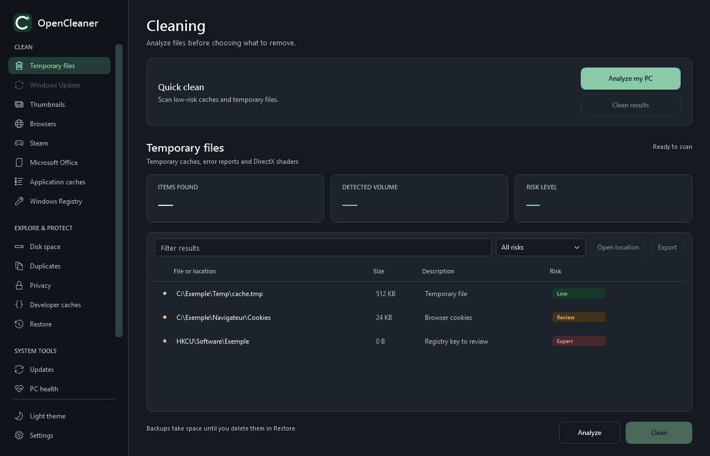
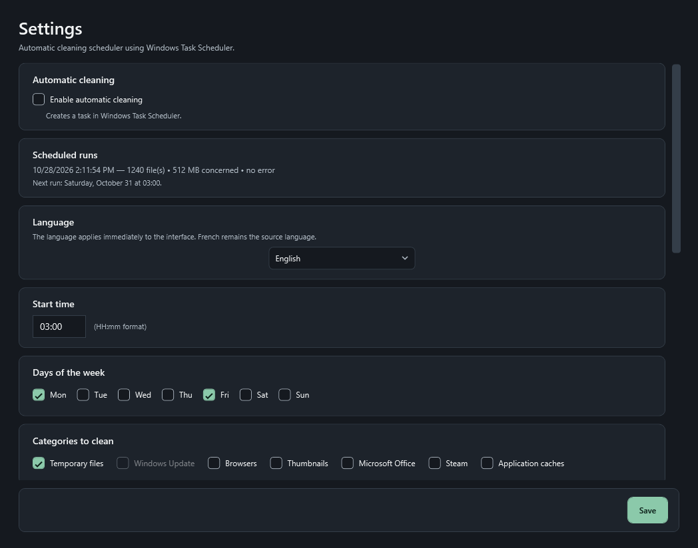

# Localisation d'OpenCleaner

Le français reste la langue source. L'anglais est introduit progressivement, avec une bascule immédiate depuis **Paramètres > Langue**.

## Architecture

- **Catalogues** : `src/OpenCleaner.UI/Localization/strings-fr.json` et `strings-en.json`, embarqués dans l'assembly. Clés plates, textes avec paramètres `{0}`, `{1}`.
- **Service** : `LocalizationService` charge les catalogues, expose `Get(clé, paramètres)`, `SetLanguage("fr"|"en")` et publie le catalogue courant dans un `ResourceDictionary` fusionné.
- **XAML** : `Text="{loc:Translate Clé}"`. L'extension s'appuie sur `DynamicResource` ; le remplacement du dictionnaire met à jour les vues sans les recréer.
- **Code** : `LocalizationService.Instance.Get("Clé", args)` (raccourci `T` dans `MainWindow`).
- **Préférence** : `Language` est enregistrée dans `%APPDATA%/OpenCleaner/preferences.json` et appliquée au démarrage avant la création de la fenêtre principale.
- **Unités et dates** : `SizeFormatter` reçoit les symboles de la langue (o/Ko/Mo/Go ou B/KB/MB/GB) ; les convertisseurs de risque et de dates relatives utilisent les mêmes clés.

## État de la migration

Migré :

- fenêtre principale complète : navigation, tableau de bord, en-têtes de catégories, filtres, colonnes, états vides, chargement, confirmations de nettoyage, export, bandeau d'espace faible ;
- fenêtre Paramètres complète : planification, exécutions, langue, exclusions, seuil d'alerte, sauvegardes, mises à jour, messages et dialogues ;
- libellés de risque, tailles, dates relatives ;
- sélecteur de langue dans les paramètres ;
- préférence persistante et bascule immédiate.

Reste à migrer (le français reste affiché) :

- Santé du PC, Espace disque et sa carte, Démarrage, Désinstallation, Mises à jour ;
- Restauration, Confidentialité, Doublons, Caches développeur, Effacement sécurisé, code de récupération ;
- descriptions générées par les plugins et messages des services Core affichés dans l'interface ;
- textes des tâches planifiées et journaux secondaires.

## Ajouter ou modifier une traduction

1. Ajouter la même clé dans `strings-fr.json` et `strings-en.json`, avec les mêmes paramètres `{0}`, `{1}`.
2. En XAML : `Text="{loc:Translate Ma.Cle}"` ; en code : `LocalizationService.Instance.Get("Ma.Cle", args)`.
3. Lancer `dotnet test` : les tests vérifient la parité des clés, l'absence de traduction vide, la cohérence des paramètres et la présence des clés principales.
4. Vérifier les deux langues avec `dotnet run --project tools/OpenCleaner.Preview -c Release -- artifacts/ui-preview` (`MainWindow-en.png`, `SettingsWindow-en.png`).

## Validation

- Tests de catalogue : parité français/anglais, clés migrées, formatage, détection de clés absentes/superflues et de paramètres différents.
- Tests de préférences : langue conservée, langue inconnue ramenée au français.
- Aperçu WPF : `MainWindow` construit en anglais, libellés, unités et états vérifiés.

## Limites

- L'anglais est **partiel** : les écrans non listés ci-dessus restent en français jusqu'à leur migration.
- Les descriptions d'éléments produites par les plugins (« Fichier temporaire », « Cookies du navigateur »…) restent en français.
- Les textes anglais peuvent être plus courts ou plus longs ; les largeurs minimales sont vérifiées au fil des migrations.
- Aucune télémétrie ni ressource distante : les catalogues sont embarqués.
